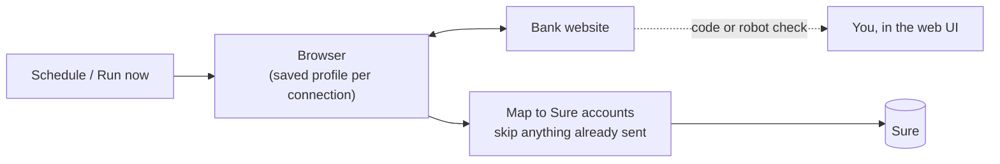
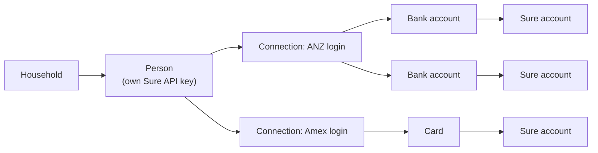

# sure-bank-sync

Pulls transactions from your banks on a schedule and imports them into a
self-hosted [Sure](https://github.com/we-promise/sure). Built for a household:
each person has their own Sure API key and bank logins, managed from one small
web UI.

There are no bank APIs or aggregators involved. It logs in to each bank's own
website with a real browser (Playwright), downloads or reads the transactions,
and sends them to Sure's API.



## What it does

- **Syncs on a schedule** per connection, or on demand, for any period up to
  the bank's limit.
- **Maps bank accounts to Sure accounts** once; unmapped accounts are skipped.
- **Never sends a transaction twice**: it keeps a record of what Sure accepted
  and checks Sure for matching rows, so overlapping periods are safe.
- **Hands the hard parts to a person**: SMS/app codes go in a box in the web UI,
  and CAPTCHAs or robot checks open a live view of the bank's page. Nothing is
  solved automatically.
- **Keeps secrets encrypted** at rest, and logs hide transaction details unless
  you turn verbose logs on.
- **Dry run** mode shows what would be sent without writing to Sure.

## How it's organised



- **Person**: someone whose banks are synced, into their own Sure accounts.
- **Connection**: one bank login for that person, e.g. `alice-anz`.
- **Account**: each account the login can see, mapped once to a Sure account.

## Supported banks

| Bank | Imports | Notes |
| --- | --- | --- |
| ANZ Internet Banking | Transactions | Up to 2 years back. |
| American Express (AU) | Card transactions | Any date range. |
| Brighten | Home loan transactions | SMS code at login; reads the portal's API. |
| CommBank NetBank | Transactions, statement PDFs | Log on approved in the CommBank app. |
| Macquarie Bank (AU) | Transactions | Robot check and SMS codes go to you. |
| Stake | ASX trades, dividends, AUD cash | AUD only; 2FA code generated from your secret. Imported as trades into an Investment account. |
| Demo bank | Fake data | For testing the pipeline. |

Adding a bank means writing one provider file (see [Development](#development)).

## Quick start

Needs Docker with the compose plugin.

```bash
mkdir sure-bank-sync && cd sure-bank-sync
curl -fsSL -o docker-compose.yml \
  https://raw.githubusercontent.com/Taaqif/sure-bank-sync/main/deploy/docker-compose.yml
curl -fsSL -o .env \
  https://raw.githubusercontent.com/Taaqif/sure-bank-sync/main/.env.example

# encryption key for saved logins, and a web UI password (user: admin)
sed -i "s|^SURE_SYNC_SECRET_KEY=.*|SURE_SYNC_SECRET_KEY=$(openssl rand -hex 32)|" .env
PASS=$(openssl rand -base64 18)
sed -i "s|^SURE_SYNC_ADMIN_PASSWORD=.*|SURE_SYNC_ADMIN_PASSWORD=$PASS|" .env
echo "Web UI login: admin / $PASS"

chmod 600 .env
docker compose up -d
```

Open `http://<your-server>:8686`. The dashboard walks you through the rest:
Sure's URL, a Sure API key per person, then a connection per bank login.

Back up `.env` (it holds the encryption key) and the `sure-bank-sync-data`
volume. Without the key, saved logins can't be read. Update with
`docker compose pull && docker compose up -d`.

## Configuration

Only `SURE_SYNC_SECRET_KEY` is required. Everything else about banks, people
and schedules lives in the web UI. The main environment variables:

| Variable | What |
| --- | --- |
| `SURE_SYNC_SECRET_KEY` | Encrypts saved logins and API keys (`openssl rand -hex 32`). |
| `SURE_SYNC_AUTH` | `password`, `oidc` (Pocket ID, Authelia, Authentik…) or `none` (only behind a proxy that logs you in). |
| `SURE_SYNC_ADMIN_PASSWORD` | Password for the `admin` login. |
| `SURE_SYNC_OIDC_*` | Issuer, client ID/secret and allowed emails or groups for single sign-on. |
| `SURE_SYNC_PUBLIC_URL`, `SURE_SYNC_TRUST_PROXY` | For running behind Caddy, Traefik or nginx. |
| `HOST_PORT` | Port on the host (default `8686`). |

The full list is in [.env.example](.env.example). Login, single sign-on and
reverse proxy setup: [docs/self-hosting.md](docs/self-hosting.md).

## Security

The container holds bank logins and logged-in browser sessions, so treat it
like a password manager:

- Always use a login (`password` or `oidc`), and serve it over HTTPS on your
  LAN or behind a VPN.
- Protect `.env` and the data volume.
- **Bank sessions** (off by default in Settings) let anyone using the web UI
  open a logged-in bank site. Only turn it on when you need it.

## Development

```bash
npm install
npx playwright install chromium
cp .env.example .env   # set SURE_SYNC_SECRET_KEY
npm run dev            # http://localhost:8686, data in ./data
npm test
```

Stack: Node + TypeScript, Playwright, Hono (server-rendered JSX), SQLite via
Drizzle. Schema changes: edit `src/db/schema.ts`, then `npm run db:generate`.

`SURE_SYNC_DEBUG=1` adds **Debug run** (visible, slowed-down browser that saves
the bank's network data) and **Train** (records your clicks in the bank's site,
with screenshots, to build or fix a provider).

**Adding a bank**: create `src/providers/<bank>.ts` exporting a
`ProviderDefinition` (login fields, `login()`, `fetchTransactions()`) and
register it in `src/providers/index.ts`. Amounts are integer cents, negative =
money out. Existing providers show both styles: reading downloads from the
bank's pages, or calling the JSON API the bank's own site uses (Stake,
Brighten).

| Path | What |
| --- | --- |
| `src/providers/` | One file per bank |
| `src/runner.ts` | One run: browser, provider, push to Sure |
| `src/push.ts` | Account mapping, duplicate checks, Sure imports |
| `src/web/` | Web UI (routes and views) |
| `src/store.ts`, `src/runs.ts` | Settings, connections, run history |

## Releasing

CI runs type checks and tests on every push. Pushing a `vX.Y.Z` tag also
publishes the Docker image to GitHub Container Registry as `X.Y.Z`, `X.Y` and
`latest`.

```bash
git tag -a v1.2.3 -m "v1.2.3" && git push origin main v1.2.3
```
