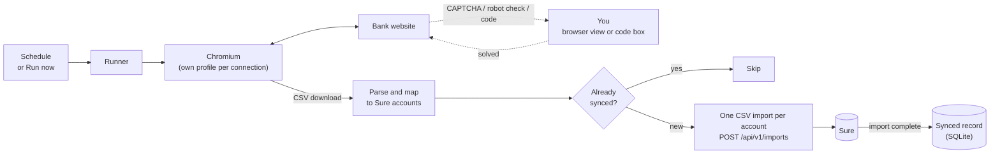

# sure-bank-sync

Scrapes transactions from your banks on a schedule and pushes them into a
self-hosted [Sure](https://github.com/we-promise/sure) instance. Built for a
shared household: each person has their own Sure API key and bank logins,
all managed from a small web UI.

Supported banks: **ANZ Internet Banking** (AU), **American Express** (AU),
**Macquarie Bank** (AU).
`demo` is a fake bank for testing the pipeline.

Stack: Node + TypeScript, Playwright, Hono (server-rendered JSX), SQLite via
Drizzle, croner.

## How it works



- **Web UI for everything**: household members (each with a Sure API key),
  bank connections, account mapping, schedules and sync periods.
- **Secrets encrypted** with `SURE_SYNC_SECRET_KEY` and never shown again.
- **Map once**: the first run (or **Discover accounts**) lists the bank's
  accounts; pick the Sure account for each. Unmapped accounts are skipped.
- **No duplicates**: a local record of what Sure confirmed, plus a check of
  the Sure account for a transaction on the same date with the same amount,
  makes re-runs and overlapping periods safe, even after you rename a
  transaction or mark it a transfer in Sure. Imports can be reverted in Sure
  as a batch.
- **A person for the hard parts**: codes go in a box on the dashboard;
  CAPTCHAs and robot checks open a live browser view. Nothing is solved
  automatically.
- **Safe to try**: **Dry run** logs what would be sent and writes nothing.
  Logs hide transactions and show only the last 4 digits of account numbers
  unless **Verbose logs** is on.
- **Run pages** show the live log, and screenshots and page HTML when a run
  fails. Runs can be cancelled at any time.
- **Runs queue politely**: scheduled runs start up to 2 minutes apart, each
  bank runs one connection at a time, and at most **Browsers at once**
  (Settings, default 2) work together. A run waiting for you hands its place
  to the next one.

## Quick start

Needs Docker with the compose plugin. Copy and paste:

```bash
# 1. Make a folder and download the compose file and settings template
mkdir sure-bank-sync && cd sure-bank-sync
curl -fsSL -o docker-compose.yml \
  https://raw.githubusercontent.com/Taaqif/sure-bank-sync/main/deploy/docker-compose.yml
curl -fsSL -o .env \
  https://raw.githubusercontent.com/Taaqif/sure-bank-sync/main/.env.example

# 2. Create the encryption key for saved logins
sed -i "s|^SURE_SYNC_SECRET_KEY=.*|SURE_SYNC_SECRET_KEY=$(openssl rand -hex 32)|" .env

# 3. Set a password for the web UI (user: admin)
PASS=$(openssl rand -base64 18)
sed -i "s|^SURE_SYNC_ADMIN_PASSWORD=.*|SURE_SYNC_ADMIN_PASSWORD=$PASS|" .env
echo "Web UI login: admin / $PASS"

# 4. Start it
chmod 600 .env
docker compose up -d
```

Open `http://<your-server>:8686`, sign in, and follow the steps on the
dashboard (the [first-time setup](#first-time-setup) below explains each one).

**Back up `.env`** (it holds `SURE_SYNC_SECRET_KEY`) and the Docker volume
`sure-bank-sync-data`. Without the key, saved logins can't be decrypted.

To update: `docker compose pull && docker compose up -d`. To use Pocket ID or
another OIDC provider instead of a password, or to run behind Caddy or
Traefik, see [Configuration](#configuration) and
[docs/self-hosting.md](docs/self-hosting.md).

### First-time setup

1. **Settings** → Sure URL (as seen from the container, e.g.
   `http://host.docker.internal:3000` if Sure runs on the same host, or its
   service name if you join Sure's compose network).
2. **Household** → add each person with a Sure API key (Sure → Settings →
   API Keys, read/write).
3. **Add connection** → pick the bank and enter the login → **Discover
   accounts** → map each bank account to a Sure account → **Run now**.

### Building from source

```bash
git clone https://github.com/Taaqif/sure-bank-sync.git && cd sure-bank-sync
cp .env.example .env    # set SURE_SYNC_SECRET_KEY and a login
docker compose up -d --build
```

## Configuration

All set with environment variables in `.env`. Only `SURE_SYNC_SECRET_KEY` is
required; everything else (Sure URL, household, banks, schedules) is set in
the web UI.

| Variable | Default | What |
| --- | --- | --- |
| `SURE_SYNC_SECRET_KEY` | (required) | Encrypts saved logins and API keys. Generate with `openssl rand -hex 32`; back it up. |
| **Login** | | |
| `SURE_SYNC_AUTH` | see below | `password`, `oidc` or `none`. Unset: `password` if a password is set, else `oidc` if an issuer is set, else `none`. |
| `SURE_SYNC_ADMIN_USER` | `admin` | Password mode user name. |
| `SURE_SYNC_ADMIN_PASSWORD` | | Password mode password. |
| `SURE_SYNC_OIDC_ISSUER` | | Provider's issuer URL, e.g. `https://id.example.com` (Pocket ID). |
| `SURE_SYNC_OIDC_CLIENT_ID` | | Client ID from the provider. |
| `SURE_SYNC_OIDC_CLIENT_SECRET` | | Client secret; leave empty for a public (PKCE) client. |
| `SURE_SYNC_OIDC_NAME` | `single sign-on` | Sign-in button text, e.g. `Pocket ID`. |
| `SURE_SYNC_OIDC_ALLOWED_EMAILS` | anyone | Comma-separated verified emails allowed in. |
| `SURE_SYNC_OIDC_ALLOWED_GROUPS` | anyone | Comma-separated groups allowed in (either list matching is enough). |
| `SURE_SYNC_OIDC_GROUPS_CLAIM` | `groups` | Claim that lists the user's groups. |
| `SURE_SYNC_OIDC_SCOPES` | `openid email profile` | Scopes to request (`groups` is added when groups are required). |
| **Reverse proxy** | | |
| `SURE_SYNC_PUBLIC_URL` | from request | External URL, e.g. `https://sync.example.com`. Needed for OIDC behind a proxy. |
| `SURE_SYNC_TRUST_PROXY` | off | `1` to trust `X-Forwarded-*` headers. Only when the proxy is the only way in. |
| **Server** | | |
| `HOST_PORT` | `8686` | Port on the host (docker compose). |
| `SURE_SYNC_PORT` | `8686` | Port inside the container. |
| `SURE_SYNC_HOST` | `0.0.0.0` | Listen address. |
| `SURE_SYNC_DATA_DIR` | `/data` | Database, browser profiles, logs and debug files. |
| `SURE_SYNC_LOG_MAX_BYTES` | `5000000` | App log size before it rotates (one old file kept). |
| `LOG_LEVEL` | `info` | `debug`, `info`, `warn` or `error`. |
| `TZ` | `Australia/Melbourne` | Container time zone (schedules use the one in Settings). |
| **Development** | | |
| `SURE_SYNC_DEBUG` | off | `1` adds Debug run and Train. |
| `SURE_SYNC_HEADLESS` | off | `1` runs Chromium headless instead of on the virtual screen. |
| `SURE_SYNC_SLOWMO` | `150` | Milliseconds between browser actions in debug runs. |
| `SURE_SYNC_PAUSE_ON_ERROR` | off | `1` opens the Playwright Inspector when a debug run fails. |

Pocket ID example:

```bash
SURE_SYNC_AUTH=oidc
SURE_SYNC_PUBLIC_URL=https://sync.example.com
SURE_SYNC_OIDC_ISSUER=https://id.example.com
SURE_SYNC_OIDC_CLIENT_ID=<client id>
SURE_SYNC_OIDC_CLIENT_SECRET=<client secret>
SURE_SYNC_OIDC_NAME=Pocket ID
SURE_SYNC_OIDC_ALLOWED_EMAILS=alice@example.com,bob@example.com
```

Register `https://sync.example.com/auth/oidc/callback` as the callback URL in
the provider. Other providers, forward-auth setups and Caddy / Traefik / nginx
examples: [docs/self-hosting.md](docs/self-hosting.md).

## Development: watching the browser

Normal runs use Chrome with a real window on an invisible virtual screen
(Xvfb, included in the Docker image), because Amex blocks windowless
(headless) Chrome. If Xvfb is missing the app falls back to headless and says
so in the run log; `SURE_SYNC_HEADLESS=1` forces headless. Start the app with
`SURE_SYNC_DEBUG=1` and each connection gets a **Debug run** button: a dry run
with a visible, slowed down browser (needs a display, e.g. WSLg on Windows)
that also saves the bank's JSON responses and downloaded files to the run's
debug folder.

```bash
SURE_SYNC_DEBUG=1 SURE_SYNC_PORT=8687 npm run dev
# SURE_SYNC_PAUSE_ON_ERROR=1 opens the Playwright Inspector when a debug run fails
```

Run logs include every page the browser visits (`nav: …`, query strings
stripped).

## Banks

**American Express (AU)**: logs in with User ID + password (ticks Remember
Me, and reuses the remembered User ID), hands any CAPTCHA to you through the
browser view and any identity check to the code box, then Dashboard → Recent
Transactions → Download → CSV. Covers the current statement period.

**Macquarie Bank (AU)**: logs in with Macquarie ID + password, hands the
"I'm not a robot" check (and anything it doesn't recognise) to you through the
browser view, trusts the browser when asked and sends SMS codes to the code
box. For each account it sets the transactions date filter to the sync period
(Add filter → Date range → Custom), then Download → .CSV. Accounts with no
transactions in the period are skipped.

**ANZ Internet Banking**: logs in with CRN + password, reads the account tiles
on the home page, then for each account clicks the tile → Download, picks a
duration covering the lookback (max 120 days) with "Microsoft Excel(CSV)", and
parses the file (date, signed amount, description).

## When a bank needs you

CAPTCHAs, "not a robot" checks and unknown login screens are handed to a
person: every page shows an orange **Needs you in the browser** banner, and
**Open browser view** streams the bank's page so you can click, type, paste
and scroll (works on phones too). One-time codes are typed into the code box
on the dashboard. The run carries on once the step is done. Nothing solves
these checks automatically.

Runs that log in often get checked more, so keep each connection's schedule
to about once a day and don't clear saved browsers unless you need to.

## Storage

**Settings → Storage** shows what uses disk space (database and run logs,
debug files, app log, saved browsers) and lets you clean each up, or
**Delete everything** (type DELETE to confirm). Settings, household, logins,
account mappings and the synced-transaction record are always kept; the
synced record is what stops transactions being sent to Sure twice.

## Train (development)

With `SURE_SYNC_DEBUG=1`, each connection has a **Train** section: pick a
recipe (date-filter, download, discover, login or your own name), and the
app opens the bank (logged in with the stored login, or at its login page),
then records each click, typed value, key press and download until you press
**Finish recording**. The run page lists every step with selector candidates,
a screenshot, the page HTML and a suggested Playwright call; the steps are
also saved as `recipe-<name>.json` in the run's debug folder. Password and
code fields are never recorded, and values that match the stored login are
saved as `{{username}}`-style placeholders. Use it to write a new provider or
fix one after a bank changes its site.

## CLI

```bash
docker compose run --rm sure-bank-sync --generate-key   # same as openssl rand -hex 32
docker compose run --rm sure-bank-sync --run alice-anz   # one run, print log, exit
```

## Development

```bash
npm install
npx playwright install chromium
cp .env.example .env   # set SURE_SYNC_SECRET_KEY
npm run dev            # http://localhost:8686, data in ./data
npm test
npm run typecheck
```

Schema changes: edit `src/db/schema.ts`, run `npm run db:generate`, commit the
new file in `drizzle/`. Migrations apply automatically on start.

### Layout

| Path | What |
| --- | --- |
| `src/main.ts` | entry point, env, CLI flags |
| `src/store.ts` | config (settings, people, connections, account mappings) |
| `src/runs.ts` | run history, synced-transaction record |
| `src/runner.ts` | one sync: browser, provider, push |
| `src/push.ts` | mapping, dedupe, upload to Sure |
| `src/scheduler.ts` | cron jobs, reloaded on config change |
| `src/providers/` | bank scrapers |
| `src/web/` | Hono routes + JSX views |

### Adding a bank

Create `src/providers/<bank>.ts` exporting a `ProviderDefinition` (name,
label, credential fields, `create(ctx)` returning `login()` and
`fetchTransactions({ since, until })`), and register it in
`src/providers/index.ts`. Use `ctx.browser` (Playwright context),
`ctx.requestMfa(prompt)` and `snapshot(ctx, name)`. Amounts are integer cents,
negative = money out.

## Releasing

`.github/workflows/ci.yml` runs the type check and tests on every push and
pull request. Pushing a release tag (`vX.Y.Z`, nothing after it) also builds
the Docker image and publishes it to GitHub Container Registry as `X.Y.Z`,
`X.Y` and `latest`. Push only the tag you're releasing:

```bash
git tag -a v0.1.0 -m "v0.1.0"
git push origin main v0.1.0
# image: ghcr.io/<your-github-user>/sure-bank-sync:0.1.0 (and :latest)
```

Deploying on a server:

1. Copy `docker-compose.yml` and your `.env` to the server. Keep the same
   `SURE_SYNC_SECRET_KEY`: without it saved logins can't be read.
2. In `docker-compose.yml`, delete the `build: .` line and set
   `image: ghcr.io/<your-github-user>/sure-bank-sync:latest`.
3. GHCR packages start private: make the package public, or run
   `docker login ghcr.io` on the server with a token that can read packages.
4. `docker compose pull && docker compose up -d`. To update later, run the
   same command again.

Data lives in the Docker volume `sure-bank-sync-data` (a fixed name, so it
doesn't depend on the folder). Back it up with your `.env`.

To change the port, set `HOST_PORT` (the port on the server) in `.env`.
`SURE_SYNC_PORT` changes the port inside the container; the compose file and
health check follow it.

## Login and reverse proxies

Set `SURE_SYNC_AUTH` to `oidc` (sign in with Pocket ID, Authelia, Authentik,
Keycloak, Google…), `password` (one admin login) or `none` (only behind a proxy
that already requires a login). Behind Caddy, Traefik or nginx also set
`SURE_SYNC_TRUST_PROXY=1` and `SURE_SYNC_PUBLIC_URL`. Setup steps, provider
notes and proxy examples: [docs/self-hosting.md](docs/self-hosting.md).

## Security notes

The container holds bank logins and logged-in browser sessions. Serve the UI
over HTTPS on your LAN or behind a VPN/reverse proxy, always use a login
(`oidc` or `password`, or `none` only behind forward auth), and protect the
`/data` volume and your `.env`. Anyone with the admin login
can change any household member's bank connection (but can't read saved
passwords back).
